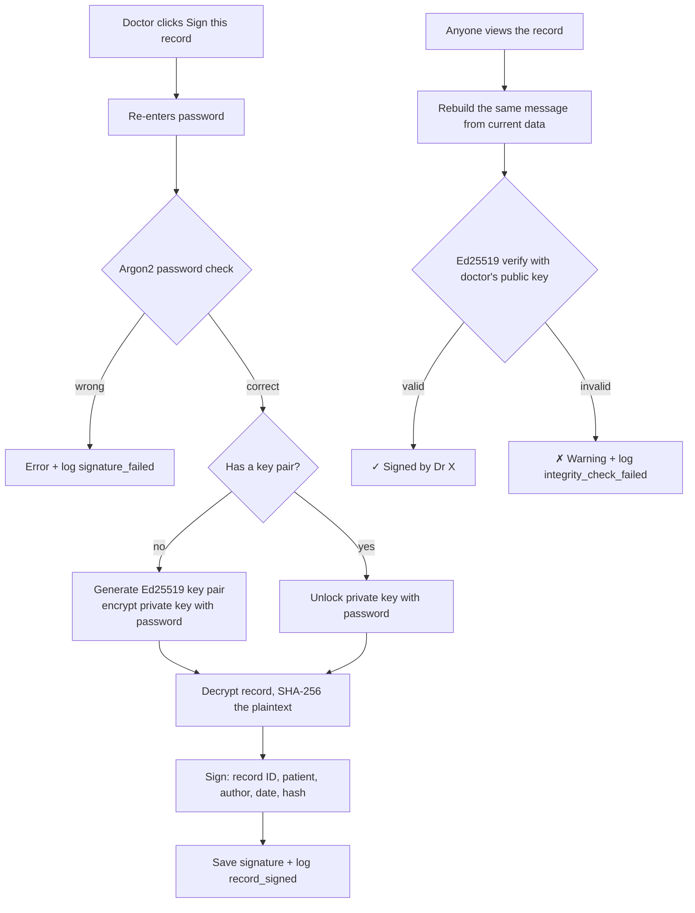

# Integrity and audit (Andrew)

## Algorithms and why

| Algorithm | Used for | Why |
|---|---|---|
| **HMAC-SHA256** | Hash chain on the audit log | A plain SHA-256 chain can be recomputed by anyone with database access. HMAC needs a secret key kept in `instance/`, outside the database, so only the app can produce valid hashes. |
| **SHA-256** | Fingerprint of a record's contents inside each signature | Any change to the record, even one character, gives a completely different hash. |
| **Ed25519** | Doctors' digital signatures on records | Modern, fast, small keys and signatures, and no randomness needed when signing (ECDSA leaks the private key if a random value is ever reused). |
| **Password-based key encryption** (`BestAvailableEncryption`) | Storing each doctor's private key | The private key is useless without the doctor's password, so only that doctor can sign. Re-entering the password to sign gives non-repudiation. |

## Security goals covered
- **Integrity:** the audit log chain and the record signatures both detect changes.
- **Non-repudiation:** only the doctor's password unlocks their signing key.
- **Accountability:** logins, failed logins, lockouts, record views, signings and integrity failures are all logged, by ID only (no medical data or passwords).

## Tampering we detect (demo)
| Attack | Caught by |
|---|---|
| Edit an audit entry | HMAC no longer matches → Verify chain fails at that entry |
| Delete an entry in the middle | Next entry's `prev_hash` doesn't link up |
| Delete the newest entries (truncation) | Anchor file in `instance/` records the newest entry |
| Change a signed record's date or patient | Ed25519 signature check fails |
| Change a record's ciphertext | AES-GCM authentication tag fails (Filip's encryption) |

## Known limitations
- Someone with access to the `instance/` folder holds every key, so they could forge anything. Real systems keep keys in a hardware security module and send log hashes to a separate server.
- Public keys are trusted from our own database. Real systems use certificates from a certificate authority.
- There's no password change feature yet. One would need to re-encrypt the doctor's private key with the new password.

## Flowchart: signing and verifying
